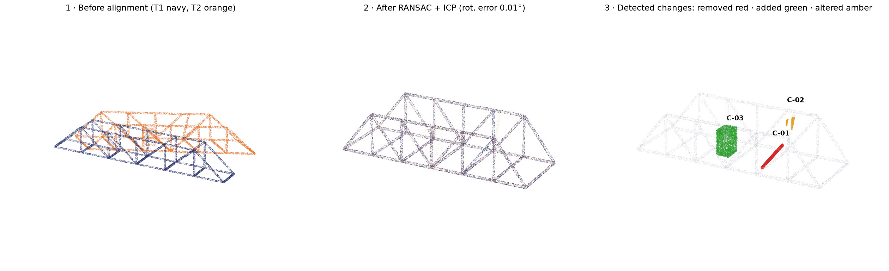

# Structural Change Detection Prototype (T1 → T2)

A small, end-to-end version of a structural monitoring pipeline: two 3D scans of a truss bridge taken at different times are **aligned**, the **changes are detected**, each change becomes a **structured record**, and a **grounded report** is written from those records only.



## What it does

1. **Data.** Builds a labelled truss bridge (T1) and a later scan (T2) with three injected changes: a removed diagonal, an added object on the deck, and a displaced vertical. T2 is rotated, shifted and noisy (1 cm), like a real second scan.
2. **Alignment.** FPFH features + **RANSAC** for coarse alignment, then point-to-plane **ICP**. A second ICP pass uses only *stable* points, so the changed regions don't bias the alignment.
3. **Detection.** Cloud-to-cloud distances in both directions (T2→T1 finds additions, T1→T2 finds removals), then **DBSCAN** clustering. A removal next to an addition is classified as a displacement.
4. **Records.** Each change becomes a JSON record: id, type, component, location, size, confidence.
5. **Evaluation.** Against the injected ground truth: precision, recall, F1, point IoU, and the alignment error versus the true transform.
6. **Report.** Rule-based severity floor (removed > altered > added); every sentence cites its record ID. With `OPENAI_API_KEY` set, an LLM also writes a summary, and any sentence without a valid record ID is rejected.

## Results

| Metric | Value |
|---|---|
| Rotation error after alignment | 0.007° |
| Translation error after alignment | 0.6 cm |
| Changes detected (TP / FP / FN) | 3 / 0 / 0 |
| Precision · Recall · F1 | 1.00 · 1.00 · 1.00 |
| Point IoU, removed member | 0.63 |

```
- HIGH · The north diagonal 4 (about 1.36 m) is missing in the second scan [C-01], confidence 1.0.
- MEDIUM · The south vertical 4 appears displaced by about 0.41 m [C-02], confidence 1.0.
- LOW · A new object of about 0.87 x 0.86 x 1.26 m appears near the floor beam 3 [C-03], confidence 0.8. Sent to an engineer for review.
```

## Limitations (honest)

- The data is synthetic and clean; real scans have occlusions, missing coverage and lighting changes.
- The removed member's IoU is 0.63 because its ends overlap the joints, where other members remain.
- Component names come from a labelled T1 model, standing in for a BIM or design model.

## Next steps

- Replace synthetic clouds with **3D Gaussian Splatting** reconstructions (Nerfstudio / gsplat) and add render-then-compare from identical viewpoints.
- Use **M3C2** distances instead of cloud-to-cloud for robustness to noise.
- Name changed components with a vision-language model on rendered crops.

## Setup and run

### 1. Requirements

- **Python 3.10, 3.11 or 3.12.** Open3D has no builds for Python 3.13 or newer yet, so `pip install open3d` fails there.
- About 500 MB of disk space for the packages (Open3D is large).

Check your versions on Windows with `py -0`. On macOS or Linux, use `python3 --version`.

### 2. Create a virtual environment

From the `prototype_1/` folder:

**Windows (PowerShell)**
```powershell
py -3.12 -m venv .venv
.\.venv\Scripts\Activate.ps1
```
If PowerShell blocks the script, run `Set-ExecutionPolicy -Scope CurrentUser RemoteSigned` once.

**macOS / Linux**
```bash
python3.12 -m venv .venv
source .venv/bin/activate
```

### 3. Install the dependencies

```bash
python -m pip install --upgrade pip
pip install -r requirements.txt
```

| Package | Used for |
|---|---|
| `numpy` | point arrays and metrics |
| `open3d` | point clouds, FPFH, RANSAC, ICP, DBSCAN |
| `matplotlib` | the `pipeline.png` figure |
| `openai` | *optional*: the LLM summary, used only when `OPENAI_API_KEY` is set |

### 4. Run

```bash
python change_detection_demo.py
```

It takes a few seconds. Results are written to `outputs/`:

| File | Content |
|---|---|
| `pipeline.png` | figure: T1, T2, aligned clouds, detected changes |
| `change_records.json` | one structured record per detected change |
| `metrics.json` | alignment error, precision / recall / F1, IoU |
| `report.md` | the grounded report |

### 5. Optional: LLM summary

The demo runs fully offline without this step. To also get an LLM-written summary, set an OpenAI key before running:

```powershell
$env:OPENAI_API_KEY = "sk-..."      # Windows PowerShell
```
```bash
export OPENAI_API_KEY="sk-..."      # macOS / Linux
```

### Troubleshooting

- **`No matching distribution found for open3d`**: your Python is 3.13 or newer. Recreate the venv with Python 3.12.
- **`python` not found on Windows**: use `py -3.12` instead, or activate the venv first.
- **`ModuleNotFoundError`**: the venv isn't active. Activate it again (step 2) in each new terminal.
